> **EN** — Computer Science student in Curitiba, Brazil. I build and ship web apps with AI and I'm looking for an IT internship (web development or data) in 2027. English: C1.

Estudante de Ciência da Computação na Universidade Tuiuti do Paraná, em Curitiba. Crio e publico aplicações web com apoio de IA e busco estágio em TI, em desenvolvimento ou dados, a partir de 2027. Também trabalho com marketing digital e conheço a rotina de uma clínica de saúde.

| Projeto | O que é | Links |
| --- | --- | --- |
| **Evolvere** | App de finanças pessoais instalável no celular, com login e chatbot que registra gastos | [Site](https://evolvere-4hk.pages.dev/) · [Código](https://github.com/MauricioGabrielVF/evolvere) |
| **App Bulla** | Agendamentos e gestão de pacientes para uma clínica real (código privado) | — |
| **Nossa Casa** | Lista de enxoval compartilhada, com login e dados no Supabase | [Site](https://mauriciogabrielvf.github.io/nossa-casa/) · [Código](https://github.com/MauricioGabrielVF/nossa-casa) |

Na faculdade também fiz programas em C: simulador de memória RAM, sistema de notas e Batalha Naval no terminal.

  

`CS50x — Harvard` · `Pre Security — TryHackMe`

